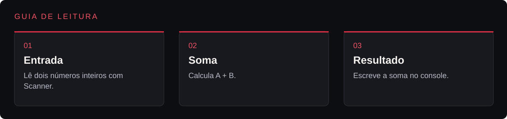
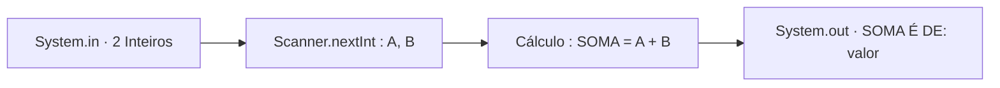

<p align="center">
  
</p>

<p align="center">Leitura de dois números inteiros e exibição da soma no console.</p>

<p align="center"></p>

<p align="center"><a href="#visão-geral">Visão geral</a> &nbsp;·&nbsp; <a href="#recursos">Recursos</a> &nbsp;·&nbsp; <a href="#como-executar">Como executar</a></p>

---

<a id="explore-o-projeto"></a>




| Área | O que você encontra | Acesso direto |
|---|---|---|
| **Entrada** | Lê dois números inteiros com Scanner. | [Abrir entrada →](SomaInt.java) |
| **Soma** | Calcula A + B. | [Abrir soma →](SomaInt.java#L16) |
| **Resultado** | Escreve a soma no console. | [Abrir resultado →](SomaInt.java#L19) |

<a id="visão-geral"></a>


**SomaInt** é um programa direto em **Java** que exercita os blocos essenciais de qualquer aplicação de console: importação da biblioteca padrão java.util.Scanner, leitura sequencial de inteiros a partir de System.in, armazenamento do resultado em variável local e escrita formatada na saída padrão (System.out.println).

<a id="recursos"></a>


| Recurso | Como funciona |
|---|---|
| Leitura interativa | Captura dois valores inteiros (A e B) informados pelo usuário no terminal. |
| Processamento direto | Calcula SOMA = A + B em tipo primitivo int. |
| Saída legível | Imprime SOMA É DE: <resultado> e encerra o leitor Scanner com segurança. |

<details>
<summary>Arquitetura</summary>



</details>

<details>
<summary>Estrutura do repositório</summary>

```text
SomaInt/
├── assets/
│   └── banner-v2.png               Banner do projeto
├── SomaInt.java                    Código-fonte da classe Main
└── README.md
```

</details>

<a id="como-executar"></a>


1. Clone o repositório:
   ```bash
   git clone https://github.com/arthurlynow098/SomaInt.git
   cd SomaInt
   ```
2. Copie SomaInt.java para Main.java, compile e execute:
   ```bash
   cp SomaInt.java Main.java
   javac Main.java
   java Main
   ```
3. Digite dois inteiros (ex.: 10 25) para visualizar SOMA É DE: 35.

---

<p align="center">
  <a href="https://github.com/arthurlynow098">GitHub</a> &nbsp;·&nbsp;
  <a href="https://arthurentsev.vercel.app/">Portfólio</a> &nbsp;·&nbsp;
  <a href="https://www.linkedin.com/in/entsevarthur/">LinkedIn</a>
</p>
